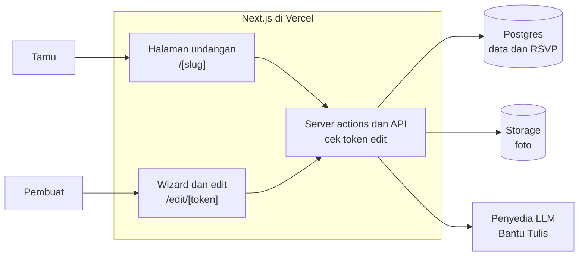

# PRD Undangan Digital — Demo v1

24 Oktober 2026 · Jovan Nathaniel

## Ringkasan

Demo v1 adalah web undangan digital self-service. Pembuat mengisi wizard, lalu membagikan link personal ke tiap tamu lewat WhatsApp. Demo pertama adalah undangan pernikahan bertema **Modern**; sweet seventeen menyusul dengan model data yang sama.

- **Tujuan demo:** latihan teknis dan riset alur kerja AI (coding agent dan aset AI), dengan tampilan setara produk jual agar bisa langsung dipakai pitching.
- **Pembuat:** pasangan atau orang tua yang membuat undangan sendiri lewat wizard, tanpa akun.
- **Tamu:** penerima link, mayoritas membuka dari browser bawaan WhatsApp atau Instagram di ponsel.
- **Positioning:** segmen massal. Pembeda utama: desain kelas premium dengan harga massal. Pendukung: link yang terasa aman dan tombol Bantu Tulis berbasis AI.
- **Pembaca dokumen ini:** AI coding agent yang membangun aplikasi (kerjakan per milestone di bagian Milestone) dan Jovan sebagai pemilik produk.

## Cakupan

Demo v1 mencakup alur lengkap dari membuat undangan sampai menerima RSVP, tanpa akun dan tanpa pembayaran.

**Masuk demo v1**

- Halaman undangan pernikahan tema Modern dengan 10 section, dari cover sampai penutup.
- Nama tamu personal lewat link (`?to=Nama`).
- Wizard pembuatan dengan live preview, tanpa akun.
- Link edit rahasia untuk mengubah undangan dan melihat respons tamu.
- Generator link tamu beserta teks pesan WhatsApp.
- RSVP dan ucapan, tampil tanpa moderasi.
- Unggah foto dengan kompresi otomatis dan pemilihan titik fokus.
- 3 sampai 5 musik bawaan.
- Tombol Bantu Tulis (AI) untuk kalimat pembuka dan section Cerita Kami.
- Preview link WhatsApp (Open Graph) dan noindex.
- Struktur paket gratis dan premium lewat feature flag, tanpa pembayaran.
- Model data dan wizard untuk sweet seventeen; tampilannya menyusul.

**Tidak masuk demo v1**

- Akun dan login, pembayaran, dashboard klien lengkap.
- Domain brand dan custom domain per acara; demo memakai subdomain hosting gratis.
- Upload musik sendiri, video, live streaming, QR check-in, multi-bahasa.
- Love story timeline bertanggal; diganti section Cerita Kami berupa satu blok teks.
- Pemrosesan dana dan upload QRIS; amplop digital hanya menampilkan info rekening.
- Moderasi ucapan dan pembatasan akses undangan.
- Editor drag-and-drop.
- Tipe acara selain pernikahan dan sweet seventeen.

## Keputusan yang sudah dikunci

Keputusan berikut final untuk demo v1. Agent tidak perlu menanyakannya ulang; perubahan hanya lewat Jovan.

| Area | Keputusan |
| --- | --- |
| Model bisnis | Self-service untuk segmen massal. Layanan "dibuatkan admin" jadi upsell setelah demo. |
| Tujuan demo | Latihan teknis dan riset AI, dengan kualitas tampilan setara produk jual. |
| Tipe acara | Model generik "acara + tipe". Demo 1 pernikahan, demo 2 sweet seventeen. |
| Tema | Modern: berbasis foto, latar gelap hangat, aksen emas. Arah adat Jawa diarsipkan. |
| Editor | Wizard form dengan live preview. Desain terkunci; pembuat hanya menyalakan atau mematikan section opsional. |
| Akses pembuat | Tanpa akun. Link edit rahasia dipakai untuk mengedit dan melihat respons. |
| Akses tamu | Siapa pun yang punya link bisa membuka. Ucapan tampil tanpa moderasi. Halaman undangan noindex. |
| URL | Satu domain brand, path per acara, nama tamu di parameter `to`. |
| Amplop digital | Hanya menampilkan info rekening dengan tombol salin, tanpa proses dana. |
| Foto | Dikompres otomatis saat unggah, ada titik fokus, galeri maksimal 10 foto. |
| Musik | 3 sampai 5 lagu royalty-free bawaan. Upload lagu sendiri adalah fitur berbayar yang nonaktif di demo. |
| AI di produk | Satu tombol Bantu Tulis, dengan batas pemakaian per undangan. |
| Paket | Arsitektur siap freemium lewat feature flag. Harga dan pembayaran ditunda. |
| Stack | Next.js, TypeScript, Tailwind CSS, Supabase, hosting di Vercel. |
| Bahasa | Antarmuka dan konten dalam Bahasa Indonesia. |
| Foto contoh | Foto AI atau foto stok berlisensi. Tidak memakai foto pernikahan orang lain dari internet. |

## Spesifikasi desain: tema Modern

Tema Modern dipimpin foto: foto prewedding penuh layar, latar cokelat-hitam hangat, aksen emas, dan ornamen nyaris nol. Acuan visualnya tiga layar di canvas [Arah Visual Undangan](https://claude.ai/artifact/LzXY1w9CQZXrHwU4NUQtES), baris "Revisi: Modern". Salinan HTML statisnya ada di repo pada `docs/design/modern/` sebagai acuan piksel untuk agent.

**Warna**

Semua pasangan teks dan latar di bawah memenuhi kontras minimal 4,5:1.

| Token | Nilai | Pemakaian |
| --- | --- | --- |
| `bg` | #1C1916 | Latar halaman |
| `surface` | #26211D | Kartu, kotak countdown, tombol musik |
| `line` | #3A332D | Garis tepi kartu |
| `text` | #F2ECE2 | Teks utama dan nama |
| `text-2` | #E9E1D4 | Tanggal dan nama lengkap |
| `muted` | #B9AFA2 | Teks pendukung |
| `accent` | #C8A46A | Tombol utama, label section, link, tanda & |
| `on-accent` | #1C1916 | Teks di atas tombol emas |
| `photo-empty` | gradien #4A4637, #2F3127, #3E3329 | Kotak foto yang belum diisi |
| `scrim` | gradien transparan ke `bg` | Lapisan gelap di bagian bawah foto cover, setinggi 540px |

**Tipografi**

Dua keluarga font dari Google Fonts: Cormorant Garamond (500, regular dan italic) dan Jost (400, 500).

| Peran | Font | Ukuran | Gaya |
| --- | --- | --- | --- |
| Nama di cover | Cormorant Garamond | 56px | Italic 500 |
| Nama panggilan mempelai | Cormorant Garamond | 46px | Italic 500 |
| Judul section | Cormorant Garamond | 42px | Italic 500 |
| Judul kartu acara | Cormorant Garamond | 30px | Italic 500 |
| Nama lengkap dan nama tamu | Cormorant Garamond | 21 sampai 24px | Regular 500 |
| Angka countdown | Jost | 26px | 500, angka tabular |
| Teks isi dan tombol | Jost | 15px | 400 isi, 500 tombol |
| Teks pendukung | Jost | 13 sampai 14px | 400 |
| Catatan kecil | Jost | 12px | 400, ukuran minimum |

**Bentuk dan jarak**

- Desain berbasis lebar 390px. Padding samping 24px, cover 32px.
- Di layar lebar, undangan tampil sebagai kolom 430px di tengah dengan latar luar `bg`.
- Radius: foto 20px, kartu 18px, kotak countdown 14px, tombol berbentuk pill.
- Tombol utama tinggi 50px berwarna emas. Tombol sekunder tinggi 44px dengan garis emas 1px.
- Target sentuh minimal 44px. Ikon bergaya garis 1,6px, tanpa emoji.
- Jarak antar-section 64 sampai 80px.

**Gerak**

- Satu momen utama: saat "Buka undangan" ditekan, cover bergeser ke atas sambil memudar selama 600ms, lalu musik mulai.
- Section lain hanya fade-in halus 400ms saat masuk layar. Tidak ada efek slide-up di setiap section.
- Jika perangkat meminta `prefers-reduced-motion`, semua animasi mati dan cover langsung hilang.

**Komponen**

Cover, SectionHeading, PhotoFrame (dengan titik fokus lewat `object-position`), PersonBlock, CountdownBox, EventCard, PrimaryButton, SecondaryButton, dan MusicToggle (bulat 46px, menempel di kiri bawah layar).

Section yang belum dimockup (galeri, Cerita Kami, RSVP, ucapan, amplop, penutup) dibangun agent dengan token dan komponen yang sama.

## Halaman undangan untuk tamu

Undangan pernikahan terdiri dari 10 section dengan urutan tetap. Section opsional bisa dimatikan pembuat; section wajib selalu tampil.

| Section | Isi | Perilaku | Status |
| --- | --- | --- | --- |
| Cover | Foto cover penuh layar, "Undangan pernikahan", nama panggilan kedua mempelai, tanggal acara pertama, "Kepada Yth." dan nama tamu, catatan maaf penulisan gelar, tombol "Buka undangan" | Halaman terkunci sampai tombol ditekan. Tombol memulai musik. Tanpa `to`, nama tamu menjadi "Bapak/Ibu/Saudara/i". | Wajib |
| Pembuka | Kalimat pembuka dari preset (per agama atau adat) atau teks sendiri, sumber kutipan opsional, paragraf ajakan hadir | Teks statis | Wajib |
| Mempelai | Per mempelai: foto, label "Mempelai pria" atau "Mempelai wanita", nama panggilan, nama lengkap dan gelar, urutan anak dan nama orang tua, link Instagram | Link Instagram hanya tampil jika diisi | Wajib |
| Cerita Kami | Judul dan satu blok teks, maksimal 1.200 karakter | Bisa diisi lewat Bantu Tulis | Opsional |
| Acara | Countdown ke acara pertama, lalu kartu per acara: nama, tanggal, jam mulai dan selesai, zona waktu, nama tempat, alamat, tombol "Buka di Google Maps". Tombol "Simpan ke kalender" di bawah. | Countdown berjalan per detik. Setelah lewat, diganti "Acara telah berlangsung". Kalender: file .ics dan link Google Calendar. | Wajib |
| Galeri | Grid 2 kolom, maksimal 10 foto | Ketuk foto untuk layar penuh, geser untuk pindah | Opsional |
| RSVP | Form: nama (terisi dari `to`, bisa diubah), Hadir atau Tidak hadir, jumlah orang 1 sampai 5 jika hadir, ucapan opsional maksimal 500 karakter, tombol "Kirim" | Setelah terkirim, form diganti pesan terima kasih | Wajib |
| Ucapan dan doa | Daftar ucapan: nama, waktu relatif, keterangan hadir atau tidak | Terbaru di atas, 20 per halaman, tombol "Muat lebih banyak". Jika dimatikan, form RSVP tidak meminta ucapan. | Opsional, default aktif |
| Amplop digital | Kartu per rekening atau e-wallet: nama bank, nomor, atas nama, tombol "Salin nomor". Alamat kirim kado opsional dengan tombol salin. | Hanya menampilkan info, tanpa proses dana | Opsional |
| Penutup | Ucapan terima kasih, nama panggilan mempelai, daftar "Turut mengundang" opsional | Paket gratis menampilkan watermark brand di sini | Wajib |

**Aturan berlaku di semua section**

- Tombol musik muncul setelah cover dibuka dan bisa menghentikan atau melanjutkan musik.
- Nama tamu dari `to` diperlakukan sebagai teks biasa, dipotong maksimal 60 karakter.
- Foto memakai titik fokus yang dipilih pembuat agar wajah tidak terpotong.

**Varian sweet seventeen**

Urutannya: Cover, Pembuka, Profil yang berulang tahun (foto, nama, nama orang tua sebagai pengundang), Acara (ditambah rundown dan dress code), Galeri, RSVP, Ucapan, Hadiah (sama dengan amplop digital), Penutup. Section Mempelai dan Cerita Kami tidak dipakai.

## Wizard pembuat, link edit, dan generator link tamu

Pembuat tidak punya akun. Sejak langkah pertama selesai, alamat halaman wizard adalah link edit rahasia, dan link itu satu-satunya kunci untuk mengubah undangan.

**Langkah wizard (pernikahan)**

1. **Jenis acara:** Pernikahan atau Sweet seventeen. Tema Modern terpilih otomatis karena satu-satunya tema di demo. Setelah "Lanjut", draf dibuat di server dan browser pindah ke `/edit/{token}`.
2. **Mempelai:** per mempelai isi nama panggilan, nama lengkap dan gelar, urutan anak, nama ayah, nama ibu, dan Instagram (opsional).
3. **Acara:** 1 sampai 3 acara. Nama acara dipilih dari preset (Akad nikah, Pemberkatan, Resepsi, Ngunduh mantu) atau diisi sendiri. Lalu tanggal, jam mulai, jam selesai atau "sampai selesai", zona waktu (WIB, WITA, WIT), nama tempat, alamat, dan link Google Maps.
4. **Foto:** foto cover, foto tiap mempelai, galeri maksimal 10. Setiap foto punya pemilih titik fokus.
5. **Teks:** kalimat pembuka dari preset atau teks sendiri, paragraf ajakan, dan Cerita Kami. Tombol Bantu Tulis ada di kalimat pembuka dan Cerita Kami.
6. **Fitur:** sakelar section opsional (Cerita Kami, Galeri, Ucapan, Amplop), data amplop (maksimal 3 rekening dan alamat kado), pilihan musik dengan pratinjau 10 detik, dan daftar "Turut mengundang".
7. **Publikasi:** alamat undangan (saran otomatis dari nama panggilan, misalnya `raka-sekar`), pengecekan ketersediaan, pratinjau akhir, lalu tombol "Publikasikan".

**Perilaku wizard**

- Live preview memakai komponen yang sama dengan halaman tamu. Di desktop, form di kiri dan pratinjau di bingkai ponsel 390px di kanan. Di ponsel, tombol "Lihat pratinjau" membuka pratinjau layar penuh.
- Data tersimpan otomatis 2 detik setelah berhenti mengetik dan setiap menekan "Lanjut".
- Kolom wajib: nama panggilan dan nama lengkap kedua mempelai, minimal satu acara lengkap (tanggal, jam mulai, tempat, alamat), dan foto cover. Tombol "Publikasikan" nonaktif sampai semuanya terisi, dengan daftar yang menunjukkan apa yang kurang.
- Perubahan setelah publikasi langsung tampil di halaman tamu.

**Link edit rahasia**

- Token berupa 32 byte acak (base64url). Server hanya menyimpan hash SHA-256 dari token.
- Banner di bagian atas halaman edit menjelaskan bahwa alamat halaman ini adalah kunci edit dan tidak bisa dipulihkan jika hilang.
- Setelah publikasi, muncul dialog berisi link undangan dan link edit, masing-masing dengan tombol "Salin". Ada juga tombol "Kirim ke WhatsApp saya" yang membuka `wa.me` berisi kedua link.
- Halaman edit punya tiga tab: **Isi undangan** (wizard), **Tamu** (generator link), dan **Respons** (daftar RSVP).
- Tab Respons menampilkan ringkasan (jumlah hadir, total orang, tidak hadir), daftar respons terbaru di atas, dan tombol "Unduh CSV".
- Tombol "Hapus undangan" dengan konfirmasi menghapus undangan, respons, dan semua foto.

**Generator link tamu (tab Tamu)**

- Pembuat menempelkan daftar nama, satu nama per baris, maksimal 500 nama sekali proses. Daftar tersimpan di server.
- Setiap nama menghasilkan link `https://{domain}/{slug}?to={nama ter-encode}` dan pesan WhatsApp dari template.
- Setiap baris punya tombol "Salin link", "Salin pesan", dan "Kirim lewat WhatsApp" (membuka `https://wa.me/?text=` berisi pesan).
- Template pesan bisa diedit dan memakai variabel `{nama_tamu}`, `{link}`, `{nama_mempelai}`. Tombol "Unduh CSV" berisi nama, link, dan pesan.
- Template bawaan menyebut nama pengirim, supaya tamu yakin pesannya bukan penipuan:

```
Kepada Yth.
{nama_tamu}

Tanpa mengurangi rasa hormat, kami mengundang Bapak/Ibu/Saudara/i untuk hadir di pernikahan kami.

Info lengkap acara ada di tautan berikut:
{link}

Merupakan kebahagiaan bagi kami apabila Bapak/Ibu/Saudara/i berkenan hadir dan memberikan doa restu.

Terima kasih,
{nama_mempelai}
```

## RSVP, Bantu Tulis, dan paket

RSVP dan ucapan memakai satu form dan satu tabel. Bantu Tulis adalah satu-satunya fitur AI di produk. Paket hanya diatur lewat feature flag karena pembayaran belum ada.

**RSVP dan ucapan**

- Form dikirim lewat server action dan divalidasi dengan Zod: nama 1 sampai 60 karakter, kehadiran `hadir` atau `tidak_hadir`, jumlah orang 1 sampai 5 jika hadir, ucapan maksimal 500 karakter.
- Semua teks disimpan dan ditampilkan sebagai teks biasa, tanpa HTML.
- Anti-spam: field honeypot tersembunyi, dan maksimal 5 kiriman per IP per undangan per jam. IP disimpan dalam bentuk hash.
- Tamu boleh mengirim lebih dari sekali; setiap kiriman jadi baris baru.

**Bantu Tulis (AI)**

- Tersedia di dua kolom: kalimat pembuka dan Cerita Kami.
- Kalimat pembuka: pembuat memilih nada (formal, hangat, santai) dan boleh menambah satu kalimat tentang mereka.
- Cerita Kami: pembuat menjawab tiga pertanyaan singkat (bagaimana bertemu, sudah berapa lama bersama, momen lamaran) dan memilih nada.
- Server memanggil LLM dan mengembalikan 2 alternatif. Pembuat memilih salah satu, lalu bisa mengeditnya.
- Instruksi ke model: Bahasa Indonesia, hanya memakai fakta dari jawaban pembuat, tidak mengutip ayat kitab suci, maksimal 80 kata untuk pembuka dan 200 kata untuk Cerita Kami.
- Batas pemakaian per undangan dicatat di database (lihat tabel paket). Timeout 20 detik.
- Jika gagal atau kuota habis, tampilkan "Bantu Tulis sedang tidak tersedia. Silakan tulis sendiri."
- Penyedia model diatur lewat environment variable `AI_PROVIDER`, `AI_API_KEY`, dan `AI_MODEL`, di balik satu modul `lib/ai`. Kunci API tidak pernah dikirim ke browser.

**Paket dan feature flag**

Semua pengecekan lewat satu fungsi `can(event, fitur)` di `lib/plans.ts`. Nilai batas disimpan di satu file konfigurasi. Selama demo, undangan baru memakai paket dari `DEFAULT_PLAN` (default `premium`), dan paket bisa diganti manual di database.

| Fitur | Gratis | Premium |
| --- | --- | --- |
| Tema | Modern | Semua tema yang tersedia |
| Watermark brand di penutup | Ya | Tidak |
| Foto galeri | 4 | 10 |
| Generator link tamu | Tidak | Ya |
| Bantu Tulis per undangan | 3 kali | 10 kali |
| Musik | Lagu bawaan | Lagu bawaan; upload sendiri nonaktif di demo |
| Masa aktif setelah acara terakhir | 7 hari | 90 hari |
| RSVP dan ucapan | Ya | Ya |

Angka batas di tabel adalah default awal dan bisa diubah Jovan. Undangan yang lewat masa aktif menampilkan "Undangan ini sudah tidak aktif."

## Model data, rute, dan arsitektur

Semua baca-tulis data lewat server Next.js dengan service role key Supabase. Browser hanya memuat foto lewat URL publik dan mengunggah foto lewat signed URL dari server.



RLS aktif di semua tabel tanpa policy untuk anon, jadi kunci publik Supabase tidak bisa membaca data apa pun.

**Tabel database**

| Tabel | Kolom | Catatan |
| --- | --- | --- |
| `events` | `id` uuid, `slug` unik (kosong sampai dipublikasikan), `type` (`wedding`, `sweet17`), `theme` (`modern`), `plan` (`free`, `premium`), `status` (`draft`, `published`), `edit_token_hash` unik, `content` jsonb, `sections` jsonb, `music_track`, `ai_uses`, `published_at`, `expires_at`, `created_at`, `updated_at` | `content` divalidasi skema Zod sesuai `type` |
| `media` | `id`, `event_id`, `kind` (`cover`, `person`, `gallery`), `person_key` (`groom`, `bride`, `celebrant`), `storage_path`, `width`, `height`, `focal_x` dan `focal_y` (0 sampai 1), `sort_order` | Ikut terhapus saat undangan dihapus |
| `guests` | `id`, `event_id`, `name`, `created_at` | Daftar nama dari generator link tamu |
| `responses` | `id`, `event_id`, `guest_name`, `attendance`, `pax`, `message`, `ip_hash`, `created_at` | RSVP dan ucapan |

**Bentuk `content` untuk pernikahan**

```ts
type Person = {
  nickname: string;      // "Raka"
  fullName: string;      // "Raka Pradipta Wibowo, S.T."
  childOrder: string;    // "pertama"
  father: string;
  mother: string;
  instagram?: string;    // tanpa @
};

type EventItem = {
  name: string;          // "Akad nikah"
  date: string;          // "2027-05-15"
  start: string;         // "08:00"
  end: string | null;    // null = "sampai selesai"
  tz: "WIB" | "WITA" | "WIT";
  venue: string;
  address: string;
  mapsUrl?: string;
};

type WeddingContent = {
  groom: Person;
  bride: Person;
  events: EventItem[];   // 1 sampai 3
  opening: { presetId: string | null; text: string; source?: string; invitation: string };
  story?: { title: string; text: string };
  gifts?: { accounts: { bank: string; number: string; holder: string }[]; address?: string };
  coInviters?: string[];
  closing: string;
};
```

Sweet seventeen memakai `celebrant` (nickname, fullName, father, mother, instagram) sebagai pengganti `groom` dan `bride`, tanpa `story`, dan setiap acara boleh punya `rundown` (daftar jam dan kegiatan) serta `dressCode`.

**Rute**

| Rute | Fungsi |
| --- | --- |
| `/` | Landing sederhana: penjelasan singkat, tombol "Buat undangan", link ke contoh |
| `/buat` | Langkah 1 wizard sebelum draf dibuat |
| `/edit/[token]` | Wizard, tab Tamu, tab Respons |
| `/[slug]` | Halaman undangan untuk tamu, nama tamu lewat `?to=` |
| `/[slug]/opengraph-image` | Gambar preview link 1200×630 |
| `/[slug]/kalender.ics` | File kalender semua acara |
| `/api/ai/bantu-tulis` | Endpoint Bantu Tulis (POST, wajib membawa token edit) |
| `/demo` | Redirect ke undangan contoh `raka-sekar` |

Aturan slug: huruf kecil a sampai z, angka, dan tanda hubung; 3 sampai 40 karakter; unik; bukan kata cadangan (`buat`, `edit`, `api`, `demo`, `admin`, `_next`).

**Struktur folder yang disarankan**

```
app/page.tsx                    landing
app/buat/page.tsx
app/edit/[token]/...            wizard, tamu, respons
app/[slug]/page.tsx             halaman undangan
themes/modern/                  komponen section tema Modern
themes/index.ts                 registri tema
lib/event-types.ts              urutan section per tipe acara
lib/schema/                     skema Zod
lib/plans.ts                    feature flag paket
lib/ai/                         Bantu Tulis
lib/supabase/server.ts          klien server-only
supabase/migrations/
supabase/seed.sql               data demo raka-sekar
docs/design/modern/             mockup HTML acuan
```

## Kebutuhan non-fungsional

Halaman undangan harus cepat dan andal di ponsel kelas menengah yang membuka link dari WhatsApp, karena dari sanalah hampir semua tamu datang.

| Area | Target |
| --- | --- |
| Tampilan | Mobile-first untuk lebar 360 sampai 430px. Di layar lebar tampil sebagai kolom 430px di tengah. |
| Performa | Lighthouse mobile Performance minimal 85 di halaman undangan. LCP maksimal 2,5 detik dengan throttling 4G Lighthouse. JavaScript halaman undangan maksimal 150 KB gzip. |
| Gambar | WebP, sisi terpanjang maksimal 1.600px. Foto cover dimuat prioritas, foto lain lazy load. |
| Browser | Chrome Android dan Safari iOS (dua versi utama terakhir), plus browser bawaan WhatsApp dan Instagram di Android dan iOS. |
| Musik | Hanya berbunyi setelah tamu mengetuk "Buka undangan". Jika browser menolak memutar, halaman tetap berjalan tanpa error. |
| Aksesibilitas | Kontras teks minimal 4,5:1, target sentuh minimal 44px, semua kontrol bisa dipakai dengan keyboard, form berlabel, alt text foto otomatis dari nama. |
| Gerak | Semua animasi mati jika perangkat meminta `prefers-reduced-motion`. |
| Indeks mesin cari | Halaman undangan memakai meta `noindex, nofollow` dan header `X-Robots-Tag` yang sama. Landing boleh diindeks. |
| Keamanan | Token edit disimpan sebagai hash. Validasi Zod di server untuk semua input. Batas kiriman RSVP dan Bantu Tulis. Unggahan maksimal 10 MB per file sebelum kompresi. |
| Format lokal | Tanggal "Sabtu, 15 Mei 2027", jam "08.00 WIB". Countdown menghitung selisih zona waktu WIB (+7), WITA (+8), dan WIT (+9). |
| Data tamu | Nama dan ucapan hanya dipakai untuk undangan tersebut dan terhapus bersama undangan. Tidak ada analytics pihak ketiga di halaman undangan selama demo. |
| Kualitas kode | TypeScript strict, ESLint, Prettier. Tes unit dengan Vitest untuk skema, paket, slug, dan token. Tes end-to-end dengan Playwright untuk alur buat, publikasi, buka undangan, lalu RSVP. |

## Milestone untuk AI coding agent

Kerjakan 12 milestone ini berurutan, satu branch per milestone. Milestone dianggap selesai hanya jika semua kriterianya terpenuhi. Hal yang tidak dijelaskan di dokumen ini diputuskan dengan opsi paling sederhana, lalu dicatat di `docs/decisions.md`.

### M0. Fondasi proyek

Next.js App Router, TypeScript strict, Tailwind CSS, ESLint, Prettier, Vitest, Playwright, Supabase CLI untuk lokal, deploy ke Vercel. Package manager: pnpm.

- [ ] `pnpm dev`, `pnpm lint`, `pnpm typecheck`, dan `pnpm test` berjalan tanpa error.
- [ ] `.env.example` mendaftar `NEXT_PUBLIC_SITE_URL`, `NEXT_PUBLIC_BRAND_NAME`, `SUPABASE_URL`, `SUPABASE_SERVICE_ROLE_KEY`, `AI_PROVIDER`, `AI_API_KEY`, `AI_MODEL`, `DEFAULT_PLAN`, dan `IP_HASH_SALT`.
- [ ] Landing sementara tampil di URL Vercel.
- [ ] Tidak ada rahasia yang masuk repo.

### M1. Token desain dan komponen dasar

- [ ] Token warna, font, radius, dan jarak sesuai bagian Spesifikasi desain, didefinisikan sebagai CSS variables dan tema Tailwind.
- [ ] Halaman `/dev/ui` (hanya di development) menampilkan semua komponen dasar.
- [ ] Cover, Mempelai, dan Acara versi statis cocok dengan mockup di `docs/design/modern/` saat dibandingkan berdampingan di lebar 390px.

### M2. Model data dan data demo

- [ ] Migrasi membuat 4 tabel dan bucket `media`, dengan RLS aktif tanpa policy untuk anon.
- [ ] Skema Zod untuk pernikahan dan sweet seventeen punya tes unit: data valid lolos, data kurang ditolak dengan pesan Bahasa Indonesia.
- [ ] `supabase/seed.sql` membuat undangan `raka-sekar` dari data demo di bagian akhir dokumen ini.
- [ ] Fungsi slug (normalisasi, validasi, kata cadangan) dan token (buat, hash, cocokkan) punya tes unit.

### M3. Halaman undangan untuk tamu

- [ ] `/raka-sekar?to=Bapak%20Hendra` menampilkan 10 section sesuai tabel Halaman undangan, dengan nama tamu di cover.
- [ ] Tanpa `to`, cover menampilkan "Bapak/Ibu/Saudara/i".
- [ ] Section opsional yang dimatikan tidak dirender.
- [ ] Halaman terkunci sampai "Buka undangan" ditekan; setelah itu musik mulai dan tombol musik muncul.
- [ ] Countdown berjalan sesuai zona waktu; tombol Maps dan file .ics bekerja.
- [ ] Galeri layar penuh bisa digeser; tombol salin di amplop bekerja.
- [ ] Slug tidak ditemukan menampilkan 404 berbahasa Indonesia; undangan lewat masa aktif menampilkan pesan tidak aktif.

### M4. RSVP dan ucapan

- [ ] Kiriman form tersimpan di `responses` dan langsung tampil di daftar ucapan.
- [ ] Pesan error tampil per kolom.
- [ ] Kiriman ke-6 dari IP yang sama dalam satu jam ditolak dengan pesan jelas; honeypot yang terisi ditolak diam-diam.
- [ ] Teks berisi HTML tampil sebagai teks biasa.

### M5. Preview link dan noindex

- [ ] Gambar Open Graph 1200×630 berisi foto cover, nama panggilan, dan tanggal. Judul halaman: "Undangan Pernikahan Raka & Sekar".
- [ ] Preview tampil benar saat link ditempel di WhatsApp (uji manual).
- [ ] Meta dan header noindex ada di halaman undangan dan tidak ada di landing.

### M6. Wizard dan publikasi

- [ ] Alur dari `/buat` sampai "Publikasikan" bisa diselesaikan di ponsel lebar 390px.
- [ ] Draf dibuat setelah langkah 1 dan URL pindah ke `/edit/[token]`; refresh tidak menghilangkan data.
- [ ] Simpan otomatis berjalan 2 detik setelah berhenti mengetik, dan live preview langsung berubah.
- [ ] Foto dikompres ke WebP maksimal 1.600px di browser, diunggah lewat signed URL, dan titik fokusnya dipakai di halaman tamu.
- [ ] Publikasi diblokir sampai kolom wajib lengkap, disertai daftar yang kurang.
- [ ] Dialog publikasi menampilkan link undangan dan link edit, tombol salin, dan "Kirim ke WhatsApp saya".

### M7. Halaman edit: tamu dan respons

- [ ] Tab Tamu: 500 nama menghasilkan 500 baris link dan pesan; salin, kirim lewat WhatsApp, dan unduh CSV bekerja.
- [ ] Template pesan bisa diedit dan ketiga variabel terganti dengan benar.
- [ ] Tab Respons: ringkasan angka benar, respons terbaru di atas, unduh CSV bekerja.
- [ ] Token salah menampilkan 404 tanpa memberi tahu apakah undangan itu ada.
- [ ] "Hapus undangan" menghapus data dan foto setelah konfirmasi.

### M8. Bantu Tulis

- [ ] Tombol di kalimat pembuka dan Cerita Kami menghasilkan 2 alternatif berbahasa Indonesia.
- [ ] Dari 5 contoh input, hasilnya tidak memuat fakta di luar jawaban pembuat dan tidak mengutip ayat.
- [ ] Kuota dihitung di server; kuota habis atau error menampilkan pesan fallback.
- [ ] Kunci API tidak muncul di bundle browser.

### M9. Paket dan feature flag

- [ ] Semua pembatasan di tabel paket lewat `can(event, fitur)`.
- [ ] Mengganti `plan` di database langsung mengubah watermark, batas galeri, generator link, dan kuota Bantu Tulis.
- [ ] `lib/plans.ts` punya tes unit.

### M10. Sweet seventeen

- [ ] Wizard mendukung tipe sweet seventeen: langkah Profil menggantikan Mempelai, dan langkah Acara punya rundown serta dress code.
- [ ] Halaman tamu merender urutan section sweet seventeen memakai tema Modern, sampai spesifikasi desainnya sendiri tersedia.
- [ ] Seed punya satu contoh undangan sweet seventeen.

### M11. Pengecekan akhir

- [ ] Lighthouse mobile memenuhi target di bagian Kebutuhan non-fungsional.
- [ ] Uji manual di browser bawaan WhatsApp dan Instagram (Android dan iOS) lolos untuk cover, musik, RSVP, salin, Maps, dan kalender.
- [ ] Tes Playwright alur utama lulus di CI.
- [ ] Mode reduced motion sudah dicek.

## Hal terbuka dan data demo

Tujuh hal di bawah disiapkan Jovan. Sampai tersedia, agent memakai placeholder dan tidak boleh mengarang aset berlisensi.

- [ ] Nama brand dan domain. Sementara memakai `NEXT_PUBLIC_BRAND_NAME` dan subdomain Vercel.
- [ ] 3 sampai 5 lagu royalty-free beserta bukti lisensinya, di `public/music/`.
- [ ] Foto contoh dari AI atau stok berlisensi: 1 cover, 2 foto mempelai, 4 sampai 6 foto galeri, di `public/demo/`.
- [ ] Teks preset kalimat pembuka per agama dan adat. Sementara agent memakai 2 preset: umum dan peribahasa Jawa.
- [ ] Penyedia LLM dan API key untuk Bantu Tulis.
- [ ] Spesifikasi desain sweet seventeen.
- [ ] Kebijakan privasi singkat sebelum dipakai klien sungguhan.

**Data demo untuk seed**

Semua nama, alamat, dan nomor rekening fiktif.

```json
{
  "slug": "raka-sekar",
  "type": "wedding",
  "theme": "modern",
  "plan": "premium",
  "status": "published",
  "music_track": "track-01",
  "sections": { "story": true, "gallery": true, "wishes": true, "gifts": true },
  "content": {
    "groom": { "nickname": "Raka", "fullName": "Raka Pradipta Wibowo, S.T.", "childOrder": "pertama", "father": "Bapak Haryo Wibowo", "mother": "Ibu Sri Lestari", "instagram": "raka.pradipta" },
    "bride": { "nickname": "Sekar", "fullName": "Sekar Ayu Kinanti, S.Ds.", "childOrder": "kedua", "father": "Bapak Bambang Kuncoro", "mother": "Ibu Ratna Dewi", "instagram": "sekar.kinanti" },
    "events": [
      { "name": "Akad nikah", "date": "2027-05-15", "start": "08:00", "end": "10:00", "tz": "WIB", "venue": "Pendopo Ndalem Sekar", "address": "Jl. Contoh No. 12, Sleman, Yogyakarta" },
      { "name": "Resepsi", "date": "2027-05-15", "start": "11:00", "end": "14:00", "tz": "WIB", "venue": "Pendopo Ndalem Sekar", "address": "Jl. Contoh No. 12, Sleman, Yogyakarta" }
    ],
    "opening": {
      "presetId": "peribahasa-jawa",
      "text": "Witing tresna jalaran saka kulina.",
      "source": "Cinta tumbuh karena terbiasa bersama.",
      "invitation": "Tanpa mengurangi rasa hormat, kami mengundang Bapak/Ibu/Saudara/i untuk hadir dan memberi doa restu di hari pernikahan kami."
    },
    "story": {
      "title": "Cerita Kami",
      "text": "Kami pertama kali bertemu di sebuah lokakarya desain di Yogyakarta pada 2021. Obrolan singkat soal kopi berlanjut menjadi kebiasaan pulang bersama, lalu menjadi rencana masa depan. Awal 2026, Raka melamar Sekar di teras rumah keluarga, disaksikan kedua orang tua."
    },
    "gifts": {
      "accounts": [ { "bank": "Bank Contoh", "number": "1234567890", "holder": "Sekar Ayu Kinanti" } ],
      "address": "Jl. Contoh No. 12, Sleman, Yogyakarta"
    },
    "coInviters": [ "Keluarga Besar Wibowo", "Keluarga Besar Kuncoro" ],
    "closing": "Merupakan kebahagiaan bagi kami apabila Bapak/Ibu/Saudara/i berkenan hadir dan memberikan doa restu. Atas kehadiran dan doa restunya, kami ucapkan terima kasih."
  },
  "responses": [
    { "guest_name": "Bapak Hendra Gunawan", "attendance": "hadir", "pax": 2, "message": "Selamat menempuh hidup baru, semoga menjadi keluarga yang sakinah dan penuh berkah." },
    { "guest_name": "Andi Saputra", "attendance": "hadir", "pax": 1, "message": "Ikut bahagia untuk kalian berdua. Sampai jumpa di Jogja!" },
    { "guest_name": "Maya Kartika", "attendance": "tidak_hadir", "pax": 0, "message": "Maaf belum bisa hadir. Doa terbaik untuk Raka dan Sekar." }
  ]
}
```

Contoh sweet seventeen untuk seed (M10): slug `nadia-17`, Nadia Putri Maharani, putri dari Bapak Arif Maharani dan Ibu Lina Kusuma. Acara Sabtu, 20 Februari 2027, 18.00 sampai 21.00 WIB di Ballroom Contoh, Jakarta, dengan rundown tiga baris dan dress code "nuansa pastel".
